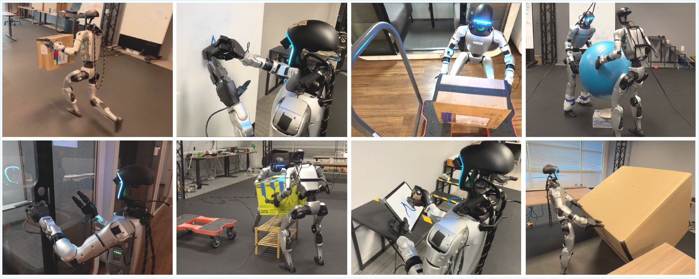

# CHIP: Adaptive Compliance for Humanoid Control through Hindsight Perturbation

Sirui Chen<sup>1,2,†</sup>, Zi-ang Cao<sup>1,3,†</sup>, Zhengyi Luo<sup>1</sup>, Fernando Castañeda<sup>1</sup>, Chenran Li<sup>1</sup>,
Tingwu Wang<sup>1</sup>, Ye Yuan<sup>1</sup>, Linxi "Jim" Fan<sup>1</sup>, C. Karen Liu<sup>2,‡</sup>, Yuke Zhu<sup>1,3,‡</sup>

<sup>†</sup> Co-first authors &nbsp; <sup>‡</sup> Equal advising &nbsp;&nbsp; <sup>1</sup>NVIDIA &nbsp; <sup>2</sup>Stanford University &nbsp; <sup>3</sup>UT Austin

[[Website]](https://nvlabs.github.io/CHIP)



*CHIP enables humanoid robots to perform manipulation tasks that require force control, such as wiping a whiteboard, door opening, lifting boxes, flipping a large object, multi-robot collaboration, and writing. It also achieves both compliant and agile humanoid control, such as holding a box while running.*

## Abstract

Despite impressive agility in locomotion, humanoid forceful manipulation remains limited by the lack of scalable, easy to train compliant force control in reinforcement learning (RL). We introduce CHIP (**C**ompliant **H**umanoid natural control through h**I**ndsight **P**erturbation), a plug-and-play framework that bridges this gap. Our core insight is that a demonstrated motion can be reinterpreted, in hindsight, as a compliant response to an external perturbation. By adjusting only sparse motion goals in response to perturbations while leaving the dense reference trajectories untouched, CHIP allows compliant interaction behaviors to emerge naturally without degrading motion tracking rewards. A single CHIP policy successfully executes forceful interaction tasks (e.g., wiping, cart pushing, door opening) alongside highly agile behaviors (e.g., dancing, running), and seamlessly extends to multi-agent cooperative transport.

## Repository Layout

| Folder | Content |
|--------|---------|
| [`train/`](train) | Isaac Lab training of the CHIP policy on the Unitree G1 (`Tracking-Flat-chip-G1-v0`) |
| [`deploy/`](deploy) | MuJoCo sim2sim and real-robot deployment of the exported local CHIP policy (ONNX) |

## Quick Start

1. **Data**: download the training motions from [Google Drive](https://drive.google.com/file/d/1S3FNFCd85MH4TYUq1rv16OWLDr99Xdus/view?usp=sharing) and unzip them (see [`train/README.md`](train/README.md#data)).
2. **Train**: `cd train && bash setup.sh && bash train.sh /path/to/twist_lafan_compliance`. The paper setup is 8 GPUs × 8192 envs.
3. **Export**: `python scripts/rsl_rl/play.py ... --checkpoint_path <model.pt>` writes `exported/policy.onnx`.
4. **Deploy**: `cd deploy`, then follow [`deploy/README.md`](deploy/README.md) to run the policy in MuJoCo or on a real G1. A pretrained policy is included in `deploy/exported_policies/local_chip/`.

## Citation

```bibtex
@article{chen_cao_2025chip,
    title={CHIP: Learning Adaptive Compliance for Humanoid Control through Hindsight Perturbation},
    author={Chen, Sirui and Cao, Zi-ang and Luo, Zhengyi and Castañeda, Fernando and Li, Chenran and Wang, Tingwu and Yuan, Ye and Fan, Linxi and Liu, C Karen and Zhu, Yuke},
    journal={Conference on Robot Learning},
    year={2026}
}
```

## Acknowledgments

Training is built on [SONIC / GR00T-WholeBodyControl](https://github.com/NVlabs/GR00T-WholeBodyControl), [BeyondMimic / whole_body_tracking](https://github.com/HybridRobotics/whole_body_tracking) and [Isaac Lab](https://isaac-sim.github.io/IsaacLab). Retargeting uses [GMR](https://github.com/YanjieZe/GMR).
